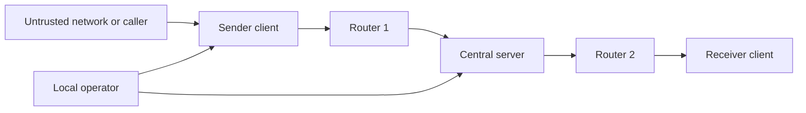

## 1. Current implementation status

- `Node` starts a threaded local HTTP server and forwards serialized payloads.
- `BaseClient` sends payloads to a configured router and receives payloads.
- `BaseRouter` inspects payloads and forwards them to the next route value.
- `FullServer` processes application requests, manages the user and session
	state, and forwards messages toward the destination client.
- `Payload` serializes the application data and route as JSON.
- The design notes also describe registration, password and two-factor login,
	sessions, reauthentication, authorization, protected messaging, key
	verification, replay checks, persistent storage, logging, rate limiting, and
	production client registration.

## 2. System and Attack Surface

### 2.1 Components and data flow

The intended path is:



The demo uses the following concrete components:

1. A `client` exposes `/receive` and the debug-only `/send` service. It sends
	application requests through its router, refreshes contacts, and polls for
	received messages. Its security concerns are fake messages and unintended
	forwarding.
2. A `router` accepts POST requests at `/`, logs the payload data and route,
	and forwards the payload to the next route. Its security concerns are
	arbitrary routes, data disclosure, and malformed forwarding.
3. A `FullServer` accepts payloads at `/payload`, reads the application data,
	dispatches registration, login, verification, session, contact, and message
	requests, and forwards messages to the selected recipient. Its security
	concerns are target validation, session checks, and delivery authorization.

### 2.2 Exposed Endpoints and Services

The client sends JSON requests through its router to the server's `/payload`
endpoint. The response is returned inside a `Payload`.

- Account service: accepts registration with username, password, and email;
	login also sends the client's router and receive addresses for delivery.
- Verification service: accepts a username and verification code after login.
- Session service: accepts a username and contact before the first message.
- Contact service: returns the current contact list and can be refreshed from
	the chat screen.
- Messaging service: accepts a username, target contact, and message, then
	forwards the result to the target client.
- Receive service: stores incoming payloads at `/receive`; the desktop client
	checks for new payloads every 250 milliseconds and displays messages with
	`sender` and `message` fields.
- The current client expects `status_code` in responses to account, verification,
	session, and message requests, and `contacts` in contact-list responses.
- `FullServer` handles the request types above and returns the matching JSON
	response or forwards a message to the recipient client.
- The normal flow is client to router to `FullServer`, followed by a response
	or a forwarded message.

### 2.3 Where Untrusted Data Enters

Data/Payloads on air are expected to be encrypted and signed. 
!! Not implemented in the version you see !!

The infrastructure treats the following as attacker-modifiable unless explicitly stated:

- Any HTTP POST sent to a node's listening address.
- The HTTP path. 
- The request body length, and the complete serialized body.
- The JSON object passed to `Payload.deserialize`, including missing fields,
	unexpected types, oversized strings, and malformed JSON.
- `Payload.data`, which is itself a JSON string and may contain arbitrary keys,
	values, nesting, or message text.
- `Payload.route`. This exists for the purpose of simulation networking. 
	CONSIDER IT AS FULLY SECURE (WON'T BE MODIFIED)
	- But intercept a payload on air completely (prevent it from reaching destination) is allowed
- Client-entered username, password, contact, and message text.
	These values can also be supplied through manually constructed payloads, so
	the service must not rely on the desktop UI for validation.
	- `Router Address` is also considered FULLY SECURE


## 3. Payload Details

Payload handling is security-sensitive because the same object carries both the
application data and the instructions for where to send it next.

### 3.1 Current wire structure

`Payload.serialize()` emits UTF-8 JSON with exactly this conceptual structure:

```json
{
	"data": "<string containing application JSON>",
	"route": "<next destination or route value>"
}
```

The `data` string is normally another JSON object. Current examples include:

```json
{
	"username": "<username>",
	"password": "<password>"
}
```

and:

```json
{
	"message": "<message text or future protected message value>",
	"target": "<recipient identifier>"
}
```

The desktop client currently creates these additional inner JSON request types:

- `register`: `type`, `username`, `password`, and `email`.
- `login`: `type`, `username`, `password`, `router`, and `client`.
- `2fa`: `type`, `code`, and `username`.
- `initiate_session`: `type`, `contact`, and `username`.
- `message`: `type`, `message`, `target`, and `username`.
- `fetch_contacts`: `type` and `username`.

The client expects a response containing `status_code` for account,
verification, session, and message requests. Contact-list responses contain a
`contacts` field, defaulting to an empty list. These are application-level
fields inside `Payload.data`, not separate URL routes. The server is responsible
for validating the `type`, checking the requester's identity, and rejecting
fields that the caller should not control.

The notes also describe fields for registration, login, reauthentication,
handshaking, and messaging. Before calling those features complete, write down
the fields each message needs, their types and size limits, who sends them, who
receives them, how freshness works, and what errors look like. The message
contract should cover missing, duplicate, extra, wrong-type, oversized, and
reordered fields.
