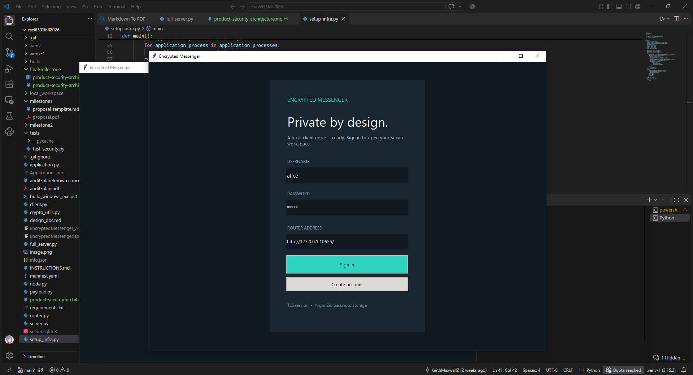
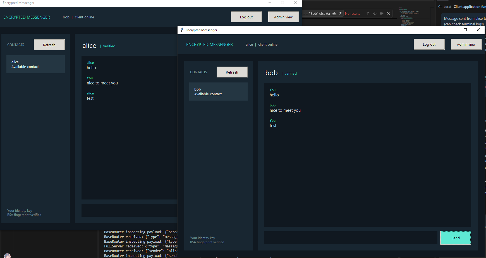
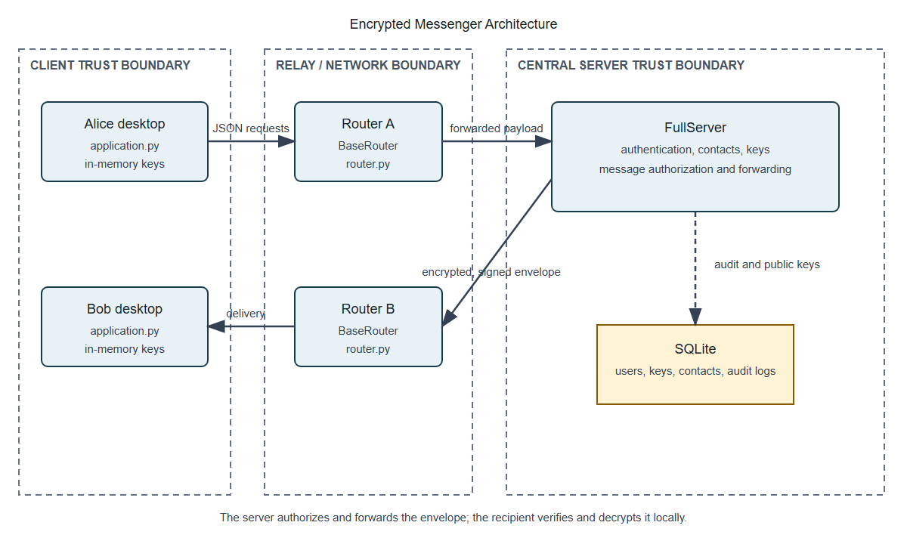

# Encrypted Messenger: Product, Architecture, and Security

## Product Overview

### Purpose and audience

Encrypted Messenger is a Python desktop app for private one-to-one messaging over a small relay network. Users create an account, sign in with a password and email-based two-factor verification, choose a contact, and send messages from the chat workspace.

The app is aimed at authenticated users who need confidential messaging in a local or academic deployment. It also includes an administrator view for monitoring service health without displaying message content.

The system has three main parts: a Tkinter desktop client, a relay/router, and a central server. The server manages accounts, sessions, contacts, public keys, audit events, and message delivery.

### Security properties

- **Password protection:** Passwords are stored as salted Argon2id records through `argon2-cffi`, so the database does not contain plaintext passwords. Legacy PBKDF2 records are recognized and upgraded when the server loads them.
- **Authentication:** Users must provide a password and a six-digit code sent by email. The code expires after five minutes and is limited to five attempts.
- **Login abuse resistance:** The server locks a username for 30 seconds after three failed password attempts. The client also applies a local lockout, and 2FA attempts are capped at five.
- **Session security:** After 2FA, the server issues a random session token with a 24-hour expiry. Tokens are compared in constant time and removed when the user logs out.
- **Authorization:** Protected requests require an authenticated session. Messages can only be sent to contacts with an established relationship.
- **Message confidentiality:** The client derives a session key with X25519 and HKDF, then encrypts messages with XChaCha20-Poly1305. Routers and the central server forward the encrypted envelope without reading the plaintext.
- **Message integrity and authenticity:** The sender signs the message metadata, nonce, and ciphertext with an RSA identity key. The recipient verifies the signature before decrypting the message.
- **Replay resistance:** Each message includes a signed and authenticated counter. The recipient rejects repeated or older counters and messages from old chat sessions.
- **Key continuity:** The client fingerprints a contact's exchange and identity public keys. A later key change is detected and rejected.
- **Persistence and auditability:** SQLite stores accounts, contacts, public keys, and audit events. Registration, login, 2FA, and logout activity remains available after a server restart.

### Primary User Interface

The login screen shows the application title, username and password fields, router address, Sign in and Create account buttons, and the security notes about TLS and Argon2id storage. It represents the first step of the authenticated workflow.

The main chat screen shows the signed-in username, online status, contacts, Refresh, verified-contact labels, the conversation transcript, message box, Send button, and Log out control. These elements represent the session-protected chat workflow: public-key checks support the verified labels, and messages are encrypted and signed before forwarding.

The login and registration screens collect the account details, email address, and router address. After the password is accepted, the login flow asks for the email verification code. The chat view includes contacts, unread indicators, a transcript, message entry, and logout. The administrator screen shows relay health and security status, although some displayed values are still demonstration data.

## Architecture and Implementation

### Architecture and Data Flow

**Figure 1. Architecture, data flow, and trust boundaries**

The client-to-router, router-to-server, server-to-router, and
router-to-recipient links are network trust boundaries. The database is a separate
persistence boundary. In this project's threat model, route values and router
addresses are trusted simulation infrastructure, while payload contents and
user-entered fields are treated as attacker-controlled.

#### Request and message sequence

1. `MessengerApp` starts a `BaseClient`, which exposes `/receive` and forwards requests to the configured router.
2. The client wraps each application request in a `Payload` containing `data` and `route`.
3. `BaseRouter` reads the route and forwards the payload. The threat model treats the route as trusted simulation infrastructure.
4. `FullServer` receives the payload at `/payload`, parses the inner JSON, and dispatches it by `type`.
5. At login, the server checks the password, emails a 2FA code, and creates an authenticated session only after the code is verified.
6. After 2FA, the client publishes its exchange and identity public keys. When the user selects a contact, the client retrieves that contact's keys, checks their fingerprint, and derives a chat-session key.
7. To send a message, the client builds associated data with the sender, target, session ID, and counter. It encrypts the plaintext and signs the associated data, nonce, and ciphertext.
8. The server checks the session and contact relationship, then forwards the envelope to the recipient. It never needs the message key or the plaintext.
9. The recipient polls `/receive`, verifies the signature, checks the session ID and counter, and decrypts the message before displaying it.

#### Trust boundaries

| Boundary | Data crossing it | Main risk or assumption |
| --- | --- | --- |
| User to desktop client | Passwords, 2FA code, contact selection, plaintext message text | Local compromise can expose input and in-memory keys. |
| Client to router | Payloads containing credentials, tokens, requests, and encrypted message envelopes | Current transport uses HTTP. Router logging can expose request data. |
| Router to central server | Registration, authentication, contact, key, and message requests | The router forwards data; the server must authenticate and authorize requests. |
| Server to recipient router/client | Forwarded message envelopes and sender metadata | Delivery and routing must be correct; the envelope is designed to remain confidential to the clients. |
| Server to SQLite | Password records, account metadata, contacts, public keys, and audit events | Database access exposes persistent account and metadata; private message plaintext is not intentionally stored. |

The project threat model treats route values and router addresses as trusted simulation infrastructure, while treating HTTP input, payload bodies, inner JSON, user fields, and message contents as attacker-controlled.

### Implementation Decisions

#### Technology stack

- Python standard library: Tkinter for the desktop UI; `http.server` and `ThreadingHTTPServer` for local HTTP nodes; `urllib.request` for forwarding; SQLite for persistence; `json` for the application protocol; `smtplib` for email 2FA; and threads for node execution.
- `argon2-cffi`: provides salted, memory-hard Argon2id password hashing with a configured `PasswordHasher`.
- `cryptography`: provides RSA identity keys and signatures, X25519 key exchange, HKDF key derivation, Ed25519 helper functions, serialization, and signature verification.
- `PyNaCl`: provides the XChaCha20-Poly1305 AEAD primitive used for message confidentiality and tamper detection.
- SQLite: provides a lightweight local database for user accounts, contacts, public keys, and audit logs.

#### Key decisions and rationale

1. **Client-side message protection.** `MessengerApp` encrypts and signs messages before they leave the client. The server and routers therefore do not need the plaintext or the per-contact message key.
2. **Authenticated encryption.** XChaCha20-Poly1305 protects confidentiality and detects changes to the ciphertext or associated data. A fresh nonce is generated for every message.
3. **Session-specific key derivation.** X25519 creates a shared secret, and HKDF turns it into a 32-byte key using a session-specific context. Different chat sessions produce different keys.
4. **Separate identity signatures.** RSA signatures bind the sender's identity to the message envelope. The recipient verifies the signature before decrypting.
5. **Explicit freshness state.** Each message includes a contact-specific counter and session ID in its authenticated data and signature. The recipient remembers the highest accepted counter and rejects older or repeated messages.
6. **Server-side session enforcement.** `FullServer._authenticate` protects the server-side operations, so security does not depend only on the UI. Session tokens are random and compared with `hmac.compare_digest`.
7. **Persistent audit trail.** Registration, login, 2FA, and logout events are written to SQLite, allowing account activity to survive a server restart.

### Security Property to Code Mapping

| Security property | Main code components | Enforcement or evidence |
| --- | --- | --- |
| Password protection | `crypto_utils.py:hash_password`, `crypto_utils.py:verify_password` | Argon2id records are salted and non-plaintext; legacy PBKDF2 records are supported and upgraded. |
| Password authentication | `FullServer._login`, `application.py:_handle_login` | Password verification occurs before 2FA is sent. Failed logins are counted and temporarily locked. |
| Email 2FA | `FullServer._send_2fa_code`, `FullServer._verify_2fa` | Codes are random six-digit values, expire after five minutes, and are limited to five attempts. Successful verification creates the session token. |
| Session security | `FullServer._authenticate`, `FullServer._logout` | Token comparison, expiry checks, and logout revocation protect session use. |
| Authorization | `FullServer.on_receive`, `FullServer._send_message` | Protected request types require authentication; messages require a known contact relationship. |
| Key publication and retrieval | `MessengerApp._fetch_contact_keys`, `FullServer._fetch_keys` | Public keys are fetched through authenticated operations, and client fingerprints detect a changed key pair. |
| Message key agreement | `crypto_utils.py:derive_message_key`, `MessengerApp._do_initiate_session` | X25519 plus HKDF derives a contact/session-specific 32-byte key. |
| Message confidentiality and tamper detection | `crypto_utils.py:encrypt_message`, `crypto_utils.py:decrypt_message` | XChaCha20-Poly1305 encrypts plaintext and authenticates associated data. |
| Message authenticity | `crypto_utils.py:rsa_sign`, `crypto_utils.py:rsa_verify` | The sender signs the message envelope, and the recipient rejects an invalid signature. |
| Replay resistance | `MessengerApp._do_send_message`, `MessengerApp._on_receive_message` | Signed counters and session identifiers allow the recipient to reject stale or repeated messages. |
| Persistence and auditability | `FullServer._initialize_database`, `FullServer._log_event` | SQLite persists accounts, contacts, keys, and audit records. |
| Payload routing | `router.py:BaseRouter`, `server.py:BaseServer` | Routers inspect and forward payloads, while the server resolves message destinations. |
